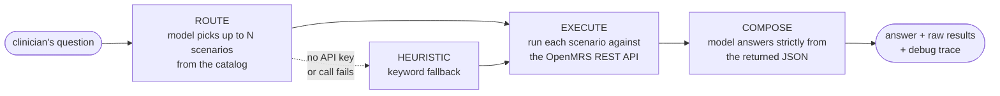

<div align="center">

# 💬 OpenMRS Chatbot

### Ask a patient's chart a question in plain English — and get an answer grounded in the live OpenMRS REST API.

An OpenMRS module that turns a clinical question into a *routed* set of REST calls against the patient's record, then composes the answer from what the API actually returned.


</div>

---

Clinicians ask questions of a record in natural language — *"what is this patient on right now?"*, *"has their blood pressure been trending up?"* Answering means knowing which of dozens of OpenMRS REST endpoints to call, with which representation, and then reading the JSON that comes back.

This module puts that behind a chat box. The design principle: **the model chooses and explains, but it never invents the data.** Every answer is composed from JSON the OpenMRS REST API actually returned during that request.

## 🔁 How a question becomes an answer



Three stages, each its own endpoint so they can be driven — and debugged — independently:

| Stage | Endpoint | What it does |
|---|---|---|
| **Route** | `POST module/chatbot/route` | Asks the model to pick up to `max` scenario names that would answer the question. Returns the choice *and* the instruction it was given. |
| **Execute** | `POST module/chatbot/execute` | Runs named scenarios against the REST API, resolving `${...}` placeholders from request context. |
| **Answer** | `POST module/chatbot/answer` | The whole pipeline end to end: route → execute → compose. |
| *(catalog)* | `GET module/chatbot/scenarios` | Returns the scenario catalog as JSON. |

## 🗂️ Scenarios are data, not code

The 20 supported questions live in [`scenarios.json`](omod/src/main/resources/chatbot/scenarios.json) — a declarative catalog. Adding a capability is a JSON entry, not a Java change:

```jsonc
{
  "name": "current_medications",
  "title": "Current medications for a patient",
  "description": "Return active medication orders (drug orders) for the patient.",
  "examples": ["What medications is this patient currently on?", "List current meds"],
  "method": "GET",
  "path": "/order",
  "queryParams": {
    "patient": "${patient.uuid}",
    "t": "drugorder",
    "isStopped": "false",
    "limit": "${limit|50}"
  },
  "requiredContext": ["patient.uuid"]
}
```

That one file does three jobs at once:

- **It is the router's menu.** `buildRoutingInstruction()` renders each entry's `title`, `description`, and `examples` into the prompt, so the model picks from a closed set of names instead of inventing an endpoint.
- **It is the executor's plan.** `ScenarioExecutor` resolves `${patient.uuid}` and `${limit|50}` (the `|` supplies a default) from request context, builds the URL, and calls it.
- **It is the precondition check.** `requiredContext` is verified *before* the call, so a scenario needing a patient UUID reports a clear error rather than issuing a malformed request.

The catalog currently covers demographics and identifiers, medication and test orders, vitals and their trends (BP, weight, temperature), encounters and visits, observations by concept and date range, lab results, and allergy read/create.

## 🛡️ Design properties worth noting

**The model never fabricates clinical data.** The composing prompt receives only the JSON returned by the REST API, and is instructed to say it cannot determine an answer rather than fill a gap. The model's job is to *read* the response, not to recall facts about the patient.

**It degrades instead of failing.** With no API key configured, or when the routing call errors, `chooseHeuristic()` falls back to keyword matching over scenario names and descriptions. The chat box keeps working without a model — with worse routing, not an error page.

**It answers as the logged-in user.** The module propagates the caller's `JSESSIONID` to its REST calls, so OpenMRS's own privilege checks apply. The chatbot cannot read a record the user could not read themselves.

**Every response carries a debug trace.** Each request returns a `debug` array recording whether model routing was attempted, whether it succeeded, and why not if it didn't (`missing_api_key`, the error text). Diagnosing a bad answer does not require server log access.

**Identifiers resolve transparently.** Ask by MRN and `ensurePatientUuid()` resolves it to a UUID against the REST API before executing, trying both `?identifier=` and `?q=` lookups.

> ### ⚠️ Patient data leaves your infrastructure
> When an OpenRouter key is configured, the question **and the REST API responses — including patient data — are sent to a third-party model provider.** Do not point this at real patient records without a legal basis for that disclosure. Read [`SECURITY.md`](SECURITY.md) before any non-demo deployment.

## 🚀 Build and install

**Prerequisites:** JDK 8, Maven 3.x, and a running OpenMRS instance.

```sh
mvn clean package          # → omod/target/chatbot-1.0.0-SNAPSHOT.omod
```

Install the `.omod` through **Administration → Manage Modules → Add or Upgrade Module**, or drop it into `~/.OpenMRS/modules/` and restart OpenMRS.

For a local dev server via the [OpenMRS SDK](https://wiki.openmrs.org/display/docs/OpenMRS+SDK):

```sh
mvn openmrs-sdk:setup      # first time only
mvn openmrs-sdk:run
```

### Configure the model

Two OpenMRS global properties, set under **Administration → Settings**:

| Property | Required | Default |
|---|---|---|
| `chatbot.openrouter.apiKey` | for model routing + answers | *(none — falls back to heuristics)* |
| `chatbot.openrouter.model` | no | `anthropic/claude-3.5-sonnet` |

Leave the key unset to run with no model at all: routing falls back to keyword matching and the compose stage is skipped. That is also the only configuration in which **no patient data leaves your network**.

## 🗃️ Project layout

```
openmrs-chatbot/
├── api/                    core module: service, DAO, activator, config
│   └── src/main/java/org/openmrs/module/chatbot/
├── omod/                   web layer — controllers, JSP, module descriptor
│   └── src/main/
│        ├─ java/.../web/controller/
│        │     ├─ ScenarioController.java    route · execute · answer endpoints
│        │     ├─ ScenarioExecutor.java      scenario → REST call, ${} resolution
│        │     ├─ OpenRouterClient.java      OpenRouter chat-completions client
│        │     └─ OpenMRSChatbotController.java
│        ├─ resources/chatbot/scenarios.json    ← the 20-scenario catalog
│        └─ webapp/chatbot.jsp                  chat UI
├── docs/                   OpenMRS REST/Core API notes + data model reference
├── .github/workflows/      CI — Maven build, tests, format check
└── pom.xml                 Maven multi-module parent
```

## 📚 Documentation

| Document | What's in it |
|---|---|
| [`docs/ARCHITECTURE.md`](docs/ARCHITECTURE.md) | the route → execute → compose pipeline, why scenarios are data, and known limitations |
| [`SECURITY.md`](SECURITY.md) | PHI disclosure to the model provider, API-key handling, the privilege model |
| [`CONTRIBUTING.md`](CONTRIBUTING.md) | build setup, how to add a scenario, code style |
| [`docs/setup-Manual.md`](docs/setup-Manual.md) | local OpenMRS setup walkthrough |
| [`docs/OpenMRS-REST-and-Core-API.md`](docs/OpenMRS-REST-and-Core-API.md) | consolidated REST + Core API reference |
| [`docs/patient-api-catalog.md`](docs/patient-api-catalog.md) | patient-facing endpoint catalog |

## 🎨 Code style

Formatting is enforced by Spotless against the OpenMRS conventions in
`OpenMRSFormatter.xml`, and runs automatically during `mvn clean package`:

```sh
mvn spotless:apply    # format
mvn spotless:check    # verify — CI runs this
```

## 📄 License

[Mozilla Public License 2.0](LICENSE), together with the
[OpenMRS Healthcare Disclaimer](http://openmrs.org/license) — matching the
OpenMRS project's own licensing.
